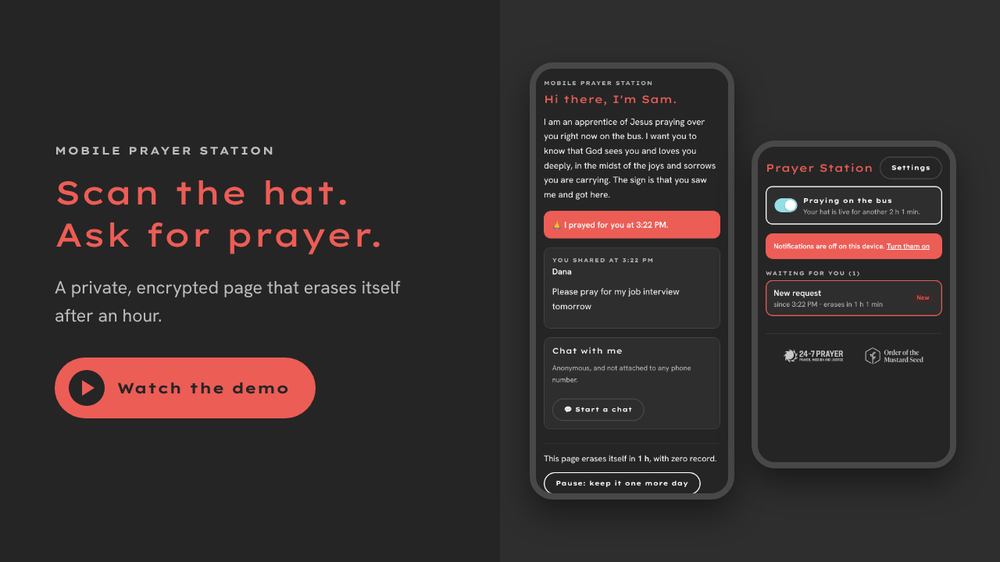

# Mobile Prayer Station

A rider scans the QR code on your hat, lands on a private page, and can share a
name, a prayer request, or chat with you anonymously. You get a notification,
pray, and tap 🙏; their page updates at once. Each page erases itself after one
hour unless the rider presses pause (each press adds 24 hours, at most 3 times and never past 72 hours in all).

## Demo

[](https://youtu.be/otHNt3nmBQg)

Watch a rider scan the hat, send a request, and see it prayed for live.

## Made for prayer and mission

<p align="center">
  <a href="https://www.24-7prayer.com"></a>
  &nbsp;&nbsp;
  <a href="https://orderofthemustardseed.com"></a>
</p>

Mobile Prayer Station is a personal project by a member of the
[Order of the Mustard Seed](https://orderofthemustardseed.com), a way of working
out the vows of Prayer and Mission, within the wider
[24-7 Prayer](https://www.24-7prayer.com) movement.

It is an independent project and not an official project of 24-7 Prayer or the
Order of the Mustard Seed.

## How it keeps its promises

- **Only the two of you can read it.** The rider's phone makes a random page
  key and locks it with the public key printed in your QR code. Requests and
  chat are encrypted with that page key before they leave either phone. The
  server stores ciphertext plus timing and status (opened / requested / prayed).
- **Zero record.** Each page is its own Durable Object. When its alarm fires it
  calls `deleteAll()`, and the address then answers exactly like one that never
  existed. Request logging is off and there are no analytics or third-party
  scripts.
- **"Praying for you right now" is true.** Pages can only be opened while your
  dashboard's on-duty switch is on (it turns itself off after 2 hours).

Limits worth knowing: the server can still see that a page exists and when; as
with any website, the encryption relies on the site serving honest code; and
Cloudflare's own storage backups are outside this app's control (anything in
them is ciphertext).

## Run it locally

```bash
npm install
```

```bash
cp .dev.vars.example .dev.vars
```

```bash
npm run vapid >> .dev.vars
```

```bash
npm run dev
```

Open `http://localhost:8787/dash`, use the setup code `dev-setup` (from
`.dev.vars`), switch on duty, then open the hat link shown under Settings in a
second browser window.

```bash
npm test
```

```bash
npm run e2e
```

`npm test` covers the encryption, the server rules and self-destruct.
`npm run e2e` drives a rider phone and your phone through the whole journey in
real browsers.

## Deploy to Cloudflare

1. Create the notification keys and a setup code:

   ```bash
   npm run vapid
   ```

   ```bash
   npx wrangler secret put VAPID_PUBLIC_KEY
   ```

   ```bash
   npx wrangler secret put VAPID_PRIVATE_KEY
   ```

   ```bash
   npx wrangler secret put SETUP_TOKEN
   ```

2. Deploy, then attach a short domain in the Cloudflare dashboard (a shorter
   address makes a bolder QR code):

   ```bash
   npm run deploy
   ```

3. On the phone you will carry, open `https://<your-domain>/dash`, enter your
   name and the setup code. On iPhone, first use Share → Add to Home Screen and
   open it from the new icon, otherwise notifications cannot work.
4. In Settings: turn on notifications, download a key backup, and download the
   QR code for your hat.
5. Remove the setup code so nobody else can create a station:

   ```bash
   npx wrangler secret delete SETUP_TOKEN
   ```

## Layout

```
src/shared/crypto.ts     key wrapping, encryption, login signatures, backup
src/worker/index.ts      HTTP routes
src/worker/session-do.ts one prayer page: ciphertext, alarm, live updates
src/worker/station-do.ts the intercessor: profile, duty, login, index, push
src/worker/webpush.ts    Web Push (VAPID + payload encryption)
src/rider/               the page riders see
src/dash/                your dashboard (installable)
test/                    Vitest suite and the browser end-to-end script
```
